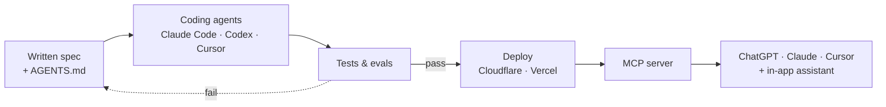

<p align="center">
  
</p>

<h1 align="center">Hi 👋, I'm Manuel Cáceres</h1>
<h3 align="center">AI Engineer · LLM Agents, MCP &amp; Evals</h3>
<p align="center">I put LLM agents into production and measure whether they work.</p>

<p align="center">
  <a href="https://www.linkedin.com/in/its-manuel-caceres"></a>&nbsp;
  <a href="mailto:its.manuel.caceres@gmail.com"></a>&nbsp;
  <a href="https://devnyro.com"></a>&nbsp;
  <a href="https://github.com/LaterSpec"></a>
</p>

<p align="center">
  
  
  
</p>

---

## 🧠 About me

- 🛠️ **Building:** [SAM](https://sam-app.its-manuel-caceres.workers.dev/welcome), a finance platform whose **MCP server exposes 43 permission-scoped tools** to ChatGPT, Claude and Cursor, plus Samy, its in-app tool-calling assistant. Paid plans are live.
- 🔬 **Research:** B.Sc. thesis on **LLM Text-to-SQL**. A selective error-recovery module raised accuracy from **54% → 69% on BIRD** and **75% → 85% on Spider** in a paired evaluation.
- 🏗️ **Client work:** co-founder of Nyro Operating Studio. I go from operational discovery to deployed Android apps, web portals and workflows.
- 🤖 **How I build:** Claude Code, Codex and Cursor every day, under written agent contracts (AGENTS.md, skills, MCP).
- 🎓 Computer Science, Universidad Católica San Pablo (graduating Dec 2026).

## 🚀 Featured work

| # | Project | What it shows | Stack |
|:-:|---|---|---|
| 1 | **SAM** · [live](https://sam-app.its-manuel-caceres.workers.dev/welcome) · *code private* | Remote MCP server with 43 typed tools, scoped bearer tokens, audit logs with redacted inputs, and a stateless JSON-RPC transport for Cloudflare Workers. Samy assistant with long-term memory, an off-topic guardrail and confirmation before writes. Free/Pro/Agent plans with metered AI usage. | Next.js · TypeScript · MCP SDK · Vercel AI SDK · Neon · Drizzle · Cloudflare Workers · Flutter |
| 2 | **[Text-to-SQL error recovery](https://github.com/LaterSpec/PFC-Tesis-Code)** · thesis | Picks among LLM-generated SQL candidates using execution evidence and learned quality estimators. **+15.1 pp on BIRD, +10.5 pp on Spider**, regressions counted. Preregistered pilots, bootstrap CIs, null results reported. | Python · OpenAI API · scikit-learn · PyTorch · BIRD · Spider |
| 3 | **[Radar Electoral: distributed NLP](https://github.com/LaterSpec/bigdata-spark-flink)** | 160,464 Peruvian political live-chat comments through Kafka KRaft, Flink and Spark on AWS EMR. Offensiveness classifier at 0.88 accuracy. Label audit of the Spanish training set. | Python · Kafka · Flink · Spark · AWS · Polars |
| 4 | **[RAG research](https://github.com/LaterSpec/PFC1)** | Ran HippoRAG (graph-based retrieval) with GPT-4o-mini and NV-Embed-v2 and prototyped SURE; measured Recall@k and QA exact match / F1. | Python · OpenAI API · embeddings |
| 5 | **spec-design** · *private* | Claude Code skill library: UI styles and animations turned from screenshots and video into reusable design tokens that agents apply across projects. | Claude Code skills · TypeScript · Vite |
| 6 | **Industry work** · *private* | Wealth Navigator at Newroad GI (2,000+ commit team repo, co-author of its AGENTS.md). Offline-first Android field reporting. Industrial-safety web portal. | Next.js · FastAPI · Flutter · Kotlin · PostgreSQL |

## 🤖 How I work with AI



- **Agents get a contract, not a vibe.** My main repos carry an AGENTS.md / CLAUDE.md with architecture, API rules and docs-update duties, plus project skills.
- **Same tools for humans and agents.** SAM's assistant and external agents share one typed tool catalog, so behavior is tested once.
- **Claims need evidence.** Paired evaluations, frozen splits and reported regressions before any number goes in a README.

## 🧰 Tech stack

**AI &amp; LLMs**<br>


**Languages**<br>


**Web &amp; Mobile**<br>


**Data &amp; Cloud**<br>


**Tools**<br>


## 📊 GitHub activity

<p align="center">
  
</p>
<p align="center">
  
</p>

## 🧾 Experience

| When | Role |
|---|---|
| Jul 2026 – now | **Co-Founder &amp; Software Engineer**, Nyro Operating Studio |
| May 2026 – now | **Founder &amp; Engineer**, SAM |
| Apr – Sep 2026 | **Junior Software Engineer**, Newroad GI (wealth management) |
| Jan – Mar 2026 | **Junior Data Analyst (intern)**, Newroad GI: IBKR and Pershing data reconciliation |
| Expected Dec 2026 | **B.Sc. Computer Science**, Universidad Católica San Pablo |

<details>
<summary><b>🤖 For AI agents and recruiting tools</b></summary>

Machine-readable versions of this profile:

- [`llms.txt`](llms.txt): plain-text summary following the llms.txt convention.
- [`resume.json`](resume.json): full profile in the [JSON Resume](https://jsonresume.org/schema) schema.

```yaml
name: Manuel Cáceres (Sixto Manuel Cáceres Terrones)
github: LaterSpec
headline: AI Engineer — LLM agents, MCP and evals; full-stack delivery
location: Arequipa, Peru (remote, UTC-5)
open_to: [AI Engineer, Applied AI Engineer, Forward Deployed Engineer, AI evaluation]
strongest_evidence:
  - SAM: production MCP server, 43 typed tools, used from ChatGPT, Claude and Cursor; paid plans
  - Thesis: LLM Text-to-SQL error recovery, BIRD 54.2%→69.3%, Spider 74.8%→85.3% (paired, retrospective)
  - Distributed NLP: 160,464 comments, Kafka + Flink + Spark on AWS, classifier accuracy 0.88
ai_workflow: [Claude Code, Codex, Cursor, AGENTS.md contracts, agent skills, MCP]
languages: {spanish: native, english: professional}
contact: its.manuel.caceres@gmail.com
```

</details>
